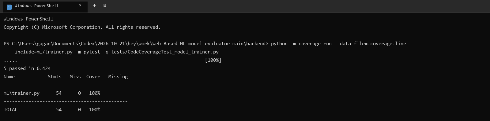
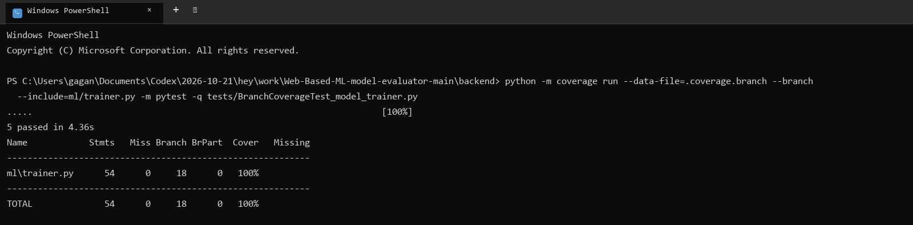

# Code and Branch Coverage

## What was measured

Coverage was added in the style of the Lab 6 handout. The handout asks for separate line-coverage and branch-coverage test files, reports showing the missing-line detail, and at least 90% coverage for the code being analyzed.

The focused subject for this exercise is the backend's core model-training module, `backend/ml/trainer.py`. It selects compatible scikit-learn estimators, trains pipelines, and serializes trained models. The line and branch test suites are separate files so their results can be demonstrated separately.

| Scope | Tests executed | Line coverage | Branch coverage | Result |
|---|---:|---:|---:|---|
| `ml/trainer.py` - line suite | 5 passed | 100% (54/54 statements) | Not collected in this run | Meets the 90% line target. |
| `ml/trainer.py` - branch suite | 5 passed | 100% (54/54 statements) | 100% (18/18 branches) | Meets both 90% targets. |
| Entire backend Python source baseline (`app`, `config`, `database`, `models`, `routes`, `ml`) | 215 passed | 85.4% (1,503/1,760 statements) | 74.3% (419/564 branches) | Baseline only; the whole backend has not reached the handout's 90% target. |

The focused result is for `ml/trainer.py`, **not** a claim of 100% coverage across the whole web application. The full-backend figures are recorded so the narrower result is not mistaken for project-wide coverage. Python coverage.py also does not measure frontend JavaScript or browser rendering; those require separate JavaScript/browser coverage tooling.

## Coverage test files

- `backend/tests/CodeCoverageTest_model_trainer.py` - tests catalog output, classification and regression training, invalid inputs, and model saving for line coverage.
- `backend/tests/BranchCoverageTest_model_trainer.py` - exercises both catalog branches, invalid/compatible estimator choices, NumPy/DataFrame input handling, scaling choices, and saving for branch coverage.
- `backend/requirements-coverage.txt` - optional developer requirements for coverage.py and pytest.

## Run on Windows PowerShell

Run from the repository's `backend` directory. The temp-directory setup keeps test fixtures under the repository's ignored `scratch` directory.

```powershell
python -m pip install -r requirements-coverage.txt
New-Item -ItemType Directory -Force .\scratch\coverage-temp | Out-Null
$coverageTemp = (Resolve-Path .\scratch\coverage-temp).Path
$env:TEMP = $coverageTemp
$env:TMP = $coverageTemp

# Line coverage
python -m coverage run --data-file=.coverage.line --include=ml/trainer.py -m pytest -q tests/CodeCoverageTest_model_trainer.py
python -m coverage report --data-file=.coverage.line -m

# Branch coverage
python -m coverage run --data-file=.coverage.branch --branch --include=ml/trainer.py -m pytest -q tests/BranchCoverageTest_model_trainer.py
python -m coverage report --data-file=.coverage.branch -m
```

To measure the whole backend, run the existing regression suite with branch measurement enabled:

```powershell
python -m coverage run --data-file=.coverage.full --branch --source=app,config,database,models,routes,ml -m unittest discover -s tests -p 'test_*.py' -q
python -m coverage json --data-file=.coverage.full -o ..\documents\coverage\full_backend.json
python -m coverage report --data-file=.coverage.full -m
```

The full-backend baseline requires 215 existing backend tests and takes longer than the focused module suites. Existing tests use temporary SQLite databases and model files; the temp variables above help on locked-down Windows configurations.

## Evidence screenshots

These screenshots show the final focused coverage command output after the 90% threshold was met:





## Interpretation and remaining coverage work

Line coverage answers whether statements were executed. Branch coverage additionally checks alternate outcomes of decisions, such as valid versus invalid task types and array versus DataFrame inputs. A high score is evidence that the recorded paths ran; it does not prove correctness by itself.

The whole-backend baseline is below 90%, particularly in dataset routes, Admin routes, preprocessing, and ML routes. Those modules need additional targeted tests before the project as a whole can be reported at 90% line and branch coverage. No source-code behavior was modified for this exercise; changes are limited to coverage tests, optional tooling requirements, coverage-output ignores, and this report/evidence.
