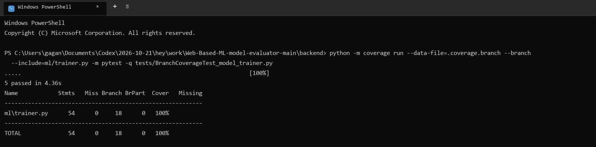

# Branch Coverage Report

**Project:** Web-Based ML Model Evaluator  
**Evidence run date:** 2026-11-07  
**Measured module:** `backend/ml/trainer.py`  
**Coverage tool:** coverage.py with branch measurement

## Results

| Scope | Tests | Statements covered | Line coverage | Branches covered | Branch coverage |
|---|---:|---:|---:|---:|---:|
| `ml/trainer.py` focused branch suite | 5 passed | 54 / 54 | 100% | 18 / 18 | 100% |
| Entire backend historical baseline | 215 passed | 1,503 / 1,760 | 85.4% | 419 / 564 | 74.3% |

The focused 100% result applies only to `ml/trainer.py`. The full-backend baseline does not meet the 90% branch target. These are existing coverage results from 2026-11-07, not a fresh coverage run on the working tree tested on 2026-11-10.

## Reproduction

Run from `backend/`:

```powershell
python -m coverage run --data-file=.coverage.branch --branch --include=ml/trainer.py -m pytest -q tests/BranchCoverageTest_model_trainer.py
python -m coverage report --data-file=.coverage.branch -m
```

## Evidence



Raw captured output: [`BranchCoverage_terminal.txt`](coverage/BranchCoverage_terminal.txt).
