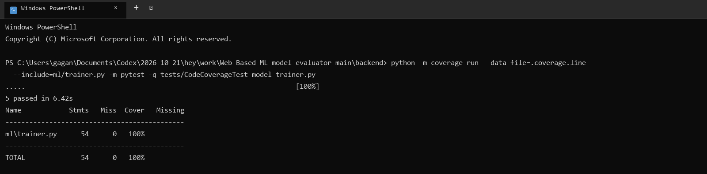

# Code Coverage Report

**Project:** Web-Based ML Model Evaluator  
**Evidence run date:** 2026-11-07  
**Measured module:** `backend/ml/trainer.py`  
**Coverage tool:** coverage.py; focused line suite

## Results

| Scope | Tests | Statements covered | Line coverage | Branch coverage collected? |
|---|---:|---:|---:|---|
| `ml/trainer.py` focused line suite | 5 passed | 54 / 54 | 100% | No |
| Entire backend historical baseline | 215 passed | 1,503 / 1,760 | 85.4% | See branch report; 419 / 564 branches (74.3%) |

The 100% result applies only to `ml/trainer.py`, not the complete application. The whole-backend baseline is below the Lab handout's 90% target. Coverage evidence predates the 2026-11-10 unit/system validation run and was not regenerated as part of this report.

## Reproduction

Run from `backend/`:

```powershell
python -m coverage run --data-file=.coverage.line --include=ml/trainer.py -m pytest -q tests/CodeCoverageTest_model_trainer.py
python -m coverage report --data-file=.coverage.line -m
```

## Evidence



Raw captured output: [`CodeCoverage_terminal.txt`](coverage/CodeCoverage_terminal.txt).
